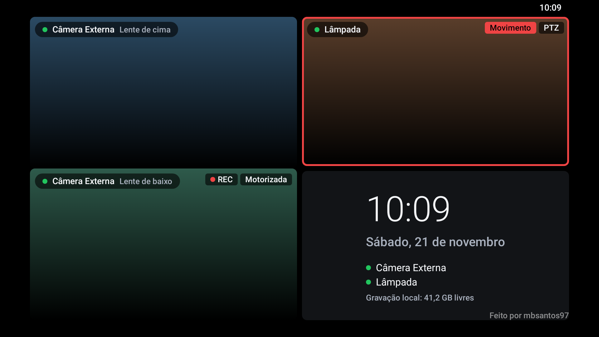
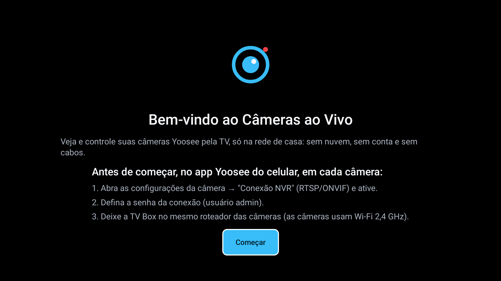
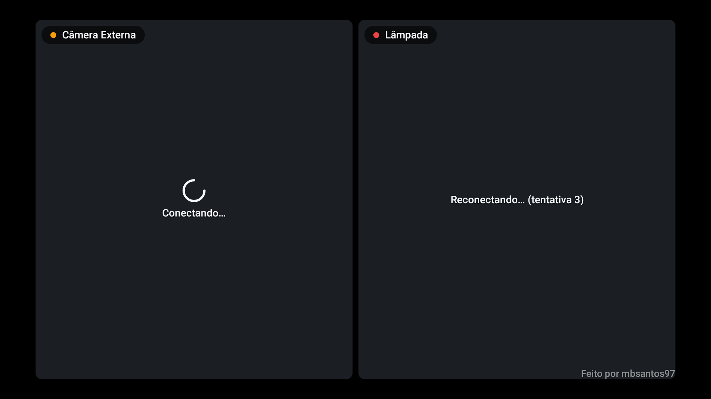

<div align="center">


# Câmeras ao Vivo

**Veja e controle suas câmeras Yoosee/Gwell na Android TV, pelo controle remoto.**
100% na rede local: sem nuvem, sem conta, sem servidor e **sem cabos**.

[](LICENSE)
[](#requisitos)
[](../../releases)

</div>



> As câmeras Yoosee baratas (marca Gwell: Yoosee, YsxLite, iCSee e parecidas) só mostram as imagens pelo app do celular, na nuvem do fabricante. Este app pega o vídeo **direto da câmera, pela rede local**, usando os padrões abertos **RTSP e ONVIF**, e mostra tudo na sua TV Box. Nenhuma imagem sai da sua casa.

## O que faz
- **Ao vivo**: grade automática (1, 2, 2×2, 3×2, 3×3 e páginas), modos "1 grande + 2" e "1 grande + 3", e um Painel com relógio e status das câmeras.
- **Lente dupla**: câmeras com duas lentes (imagem empilhada) aparecem em **dois quadrados** ("Fixa" e "Móvel"), usando um único decodificador para poupar memória.
- **Tela cheia instantânea**: mostra na hora o substream ampliado e troca para o principal sem tela preta.
- **Controle de movimento (PTZ)** pelas setas do controle: segurar move, soltar para; diagonais, zoom digital, foto, áudio, ronda automática.
- **Gravações**: cartão SD da câmera via ONVIF Profile G (quando houver), **gravação na própria TV Box** em segundo plano (pendrive recomendado) e fotos.
- **Configurar pelo celular**: QR code + PIN; nada de digitar IP com o controle remoto.
- **Resiliente e leve**: reconexão automática, abre em ~0,7 s, ~96 MB de RAM e ~8% de CPU na Xiaomi TV Box S.
- **Privado por padrão**: só conversa com endereços da rede local; sem Firebase, sem Play Services, sem analytics, sem rastreadores.

## Telas
| Boas-vindas | Estados de conexão |
|---|---|
|  |  |

## Requisitos
- **TV Box / TV com Android TV 7.0+** (testado na Xiaomi TV Box S 2ª geração; vale Mi Box S, Mi TV Stick e similares).
- **Câmeras Yoosee/Gwell** com a opção **"Conexão NVR"** (RTSP/ONVIF) ativada e com senha — veja [docs/CONFIGURAR_CAMERAS_YOOSEE.md](docs/CONFIGURAR_CAMERAS_YOOSEE.md).
- TV Box e câmeras no **mesmo roteador e mesma sub-rede**. As câmeras usam Wi-Fi 2,4 GHz; se der, deixe a TV Box no 5 GHz do mesmo roteador.

## Instalação na TV Box (sem cabos)
1. Baixe o APK da página de [**Releases**](../../releases). Para a maioria das TV Box use `CamerasAoVivo-vX.Y.Z-armeabi-v7a.apk`; na dúvida, o `universal`.
2. **Prepare a TV Box (uma vez):**
   - Configurações → Preferências do dispositivo → **Sobre** → clique **7 vezes** em **Build** (vira desenvolvedor).
   - Opções do desenvolvedor → ative a **Depuração** (no Mi Box S isso abre a depuração pela rede, porta 5555, sem cabo). Em Google TV pode ser **Depuração sem fio** com código.
   - Segurança → permita **Fontes desconhecidas** para o app que vai abrir o APK.
3. **Instale de uma destas formas (todas sem cabo):**
   - **adb pela rede (PC):** `scripts/install-tv.sh IP_DA_TV` (Linux/macOS/Git Bash) ou `.\scripts\install-tv.ps1 -Ip IP_DA_TV` (Windows). Na 1ª vez, confirme "Permitir depuração" na TV.
   - **Celular:** baixe o APK e envie à TV com o app "Send Files to TV".
   - **Pendrive:** copie o APK e abra com um gerenciador de arquivos na TV.

## Primeiro uso
1. Abra **Câmeras ao Vivo** → **Começar** → **Configurar pelo celular**.
2. No celular (mesmo Wi-Fi), leia o QR code e digite o PIN mostrado na TV.
3. Para cada câmera: nome, **IP da câmera na rede** (ex.: `192.168.1.50` — **não** é o ID do app Yoosee), usuário `admin` e a senha da "Conexão NVR".
4. **Concluir**: a grade abre ao vivo.

Resumo do controle remoto em [docs/CONTROLE_REMOTO.md](docs/CONTROLE_REMOTO.md).

## Compatibilidade
Feito e testado com câmeras **Gwell/Yoosee** (firmware "Technology/IPC"), que têm várias particularidades no ONVIF — o app já contorna todas (veja [docs/LIMITACOES.md](docs/LIMITACOES.md)). Deve funcionar com outras câmeras ONVIF/RTSP, com recursos a mais quando a câmera oferecer (presets, Profile G, eventos de movimento).

**O que essas câmeras Yoosee NÃO entregam pela rede** (limitação do firmware, não do app): clipes gravados no cartão SD (sem ONVIF Profile G), presets/ponto de guarda e aviso de movimento. Esses recursos só existem no app oficial Yoosee. Para ter gravação na TV, use a **gravação na TV Box**.

## Como funciona
Compose + tv-material, player com LibVLC, cliente ONVIF escrito à mão (WS-Security, HTTP Digest, SOAP 1.1/1.2) e descoberta na rede. Detalhes em [docs/ARQUITETURA.md](docs/ARQUITETURA.md), [docs/DESIGN_SYSTEM.md](docs/DESIGN_SYSTEM.md) e [docs/PERFORMANCE.md](docs/PERFORMANCE.md).

## Compilar
Precisa de JDK 17 e do Android SDK (plataforma 37.2, build-tools 37.0.0).
```
./gradlew :app:assembleRelease     # APK por ABI
./gradlew :app:distApks            # copia os APKs para dist/
./gradlew ktlintCheck :app:lintDebug :app:testDebugUnitTest   # verificação
```
Para assinar o release, crie um `keystore.properties` na raiz (veja `keystore.properties.example`) ou use as variáveis de ambiente `KEYSTORE_FILE`/`KEYSTORE_PASSWORD`/`KEY_ALIAS`/`KEY_PASSWORD`. Sem isso, o release sai assinado com a chave de debug (só para testes).

## Privacidade e segurança
- O app bloqueia qualquer conexão fora das faixas de rede local (um "guarda" no HTTP, no DNS e nos sockets).
- Senhas das câmeras são cifradas (AES-GCM no Android Keystore) e **nunca** aparecem nos logs.
- **Não** faz engenharia reversa do protocolo P2P da Yoosee nem usa a nuvem do fabricante.
- No seu roteador, mantenha o **redirecionamento de portas desligado** e o **UPnP desativado**.

## Contribuindo
Issues e pull requests são bem-vindos. Nunca inclua IPs reais, seriais, senhas ou keystores nos PRs. Decisões de projeto ficam em [docs/DECISOES.md](docs/DECISOES.md).

## Licença
[MIT](LICENSE) © mbsantos97. Bibliotecas de terceiros em [NOTICE.md](NOTICE.md).
