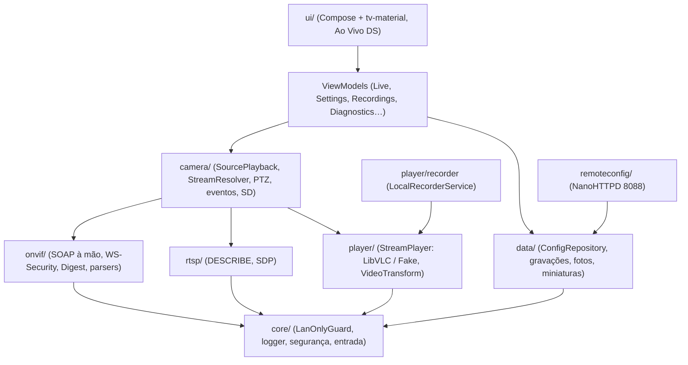

# Arquitetura

- A UI nunca fala com OkHttp ou LibVLC: passa pelos ViewModels e pela camada `camera`.
- **DI manual** em `di/AppContainer` (tudo `lazy`; nada de rede nem LibVLC na abertura).
- **Uma instância de LibVLC**; um `MediaPlayer` por fonte visível (substream na grade, principal só em tela cheia).
- **Vídeo**: `VideoSurface` (TextureView) criado uma vez por fonte; recorte de lente, zoom e proporção pela matriz do TextureView (`VideoTransform`). A lente dupla empilhada usa **um** decodificador para os dois quadrados.
- **Reprodução resiliente**: `SourcePlayback` (backoff 2–30 s, watchdog de 10 s, fallback para decodificação por software e alternância UDP/TCP, re-resolução e busca da câmera por serial/MAC).
- **ONVIF tolerante**: XAddr deslocado → `device_service`; relógio com/sem autenticação; `Connection: close`; Stop recusado → velocidade zero.
- **Persistência**: DataStore (JSON) com senhas cifradas em AES-GCM pelo Android Keystore.
- **Privacidade**: `LanOnlyGuard` no OkHttp, no DNS e antes de abrir RTSP/sockets.

## Fluxo de abertura
1. `Application`: logger + contêiner preguiçoso.
2. Splash nativa enquanto a configuração é lida.
3. Grade imediata com miniaturas em cache.
4. LibVLC e streams (URIs em cache) fora da main thread.
5. Depois do primeiro quadro, validação ONVIF em segundo plano.
