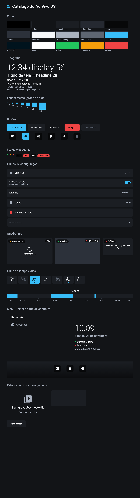
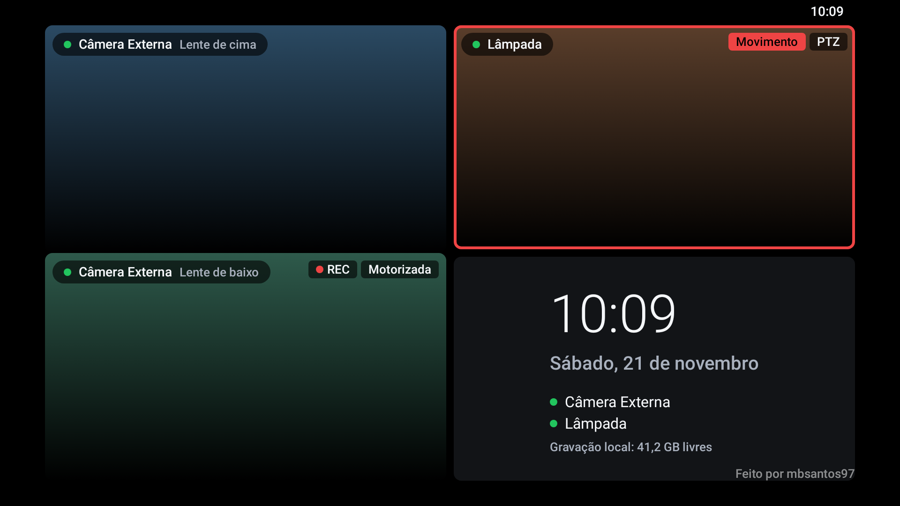
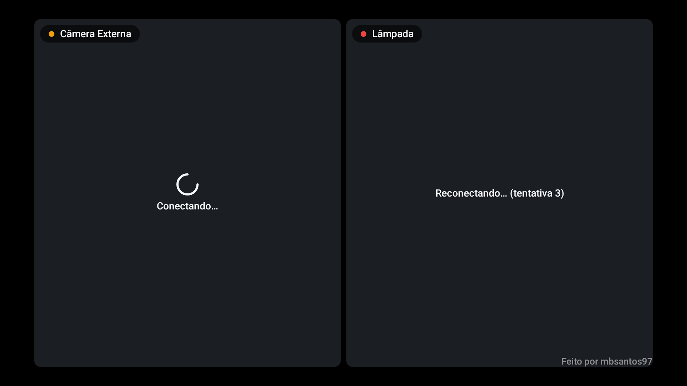

# Ao Vivo DS

Design system do Câmeras ao Vivo: o vídeo é o protagonista, a interface é sóbria e o custo de renderização é mínimo em hardware fraco. Código em `app/src/main/java/br/com/aoVivo/cameras/ui/designsystem/`, exposto por `AoVivoTheme` (CompositionLocals) e mapeado para o `MaterialTheme` do tv-material.

## Princípios
1. **Vídeo primeiro**: interface mínima sobre o vídeo; controles só quando chamados.
2. **Legível a 3 metros**: nada abaixo de 13 sp, alto contraste.
3. **Foco inequívoco**: anel branco + escala, nunca só cor.
4. **Calmo**: poucas animações, curtas. Contínuas, só "conectando" e o ponto de REC.
5. **Leve**: sem blur, sombras, gradientes animados, imagens de fundo ou fontes baixadas.

## Tokens

### Cores (tema escuro único)
| Token | Valor | Uso |
|---|---|---|
| `bg` | `#000000` | fundo atrás do vídeo e da grade |
| `surface` | `#121417` | menu lateral, Painel, telas de configuração |
| `surfaceRaised` | `#1B1E23` | cards, linhas, diálogos |
| `surfaceHigh` | `#252931` | linha/botão focado |
| `scrim` | `#000000` 60% | pílulas e barras sobre o vídeo |
| `outline` | `#2C313A` | divisórias e bordas de 1 dp |
| `textPrimary` | `#F5F7FA` | texto principal |
| `textSecondary` | `#A9B1BE` | texto de apoio |
| `textDisabled` | `#5E6672` | desabilitado |
| `accent` | `#38BDF8` | marca, toggles, progresso, trechos gravados |
| `onAccent` | `#00131D` | texto sobre `accent` |
| `focus` | `#FFFFFF` | anel de foco |
| `online` / `connecting` / `danger` | `#22C55E` / `#F59E0B` / `#EF4444` | status, REC, movimento |

`TokensContrastTest` valida 4,5:1 nos pares texto × fundo. Texto em `danger` não é usado sobre `surfaceRaised` (4,44:1): o botão perigoso usa fundo `danger` com texto preto e a linha perigosa usa ícone `danger`.

### Tipografia (fonte do sistema)
`display` 56/300 (relógio, números tabulares) · `headline` 28/500 · `title` 20/500 · `body` 16/400 · `label` 14/500 · `caption` 13/500.

### Espaçamento, formas e movimento
- Grade de 4 dp: `xxs 4`, `xs 8`, `sm 12`, `md 16`, `lg 24`, `xl 32`, `xxl 48`. Área segura 48 × 27 dp. Espaço entre quadrantes 8 dp.
- Formas: `radiusSm 4`, `radiusMd 8`, `radiusLg 12`, `pill`. Sem sombras: profundidade só por degraus de `surface` + `outline`.
- Movimento: `fast 120 ms` (foco), `medium 200 ms` (barra, fades), `slow 250 ms` (troca de tela). Crossfade da tela cheia 150 ms. Toque longo 600 ms.

## Foco
- **Quadrante**: anel `focus` de 3 dp por fora + contorno interno preto de 1 dp + escala 1.04 (no `graphicsLayer`, sem relayout).
- **Linhas e botões**: fundo `surfaceHigh`, borda branca interna, escala 1.02.
- `Modifier.aoVivoClickable` (antes de `aoVivoFocus` na cadeia): OK curto no KeyUp, OK longo aos 600 ms segurando (o KeyUp seguinte é ignorado).

## Componentes
| Componente | Arquivo | Observações |
|---|---|---|
| `AoVivoButton` (primário, secundário, fantasma, perigoso) | `Buttons.kt` | |
| `AoVivoIconButton` | `Buttons.kt` | rótulo aparece abaixo quando focado |
| `StatusDot`, `Tag`, `RecBlink`, `ConnectingIndicator` | `Status.kt` | REC pisca a 1 Hz por alpha |
| `NavigationRow`, `ToggleRow`, `SelectorRow`, `TextEntryRow`, `DangerRow`, `InfoRow`, `SectionHeader`, `AoVivoSwitch` | `SettingsRows.kt` | `SelectorRow` troca o valor com ←/→ |
| `AoVivoDialog`, `TextInputDialog`, `TvToastHost`, `EmptyState`, `Skeleton` | `Overlays.kt` | foco inicial no botão seguro |
| `DrawerItem`, `ControlBar` | `NavigationComponents.kt` | |
| `TimelineBar`, `DayPicker` | `Timeline.kt` | linha do tempo num único `Canvas`, cursor lido na fase de desenho |
| `CameraTileOverlay`, `InfoPanel`, `Watermark`, `Clock`, `TvSafeArea` | `ui/components/` | |

## Telas

Os prints são gerados pela JVM (`./gradlew :app:testDebugUnitTest --tests "*ScreenshotTest*" -Pscreenshots`); nelas o vídeo é simulado por um gradiente.
